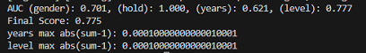
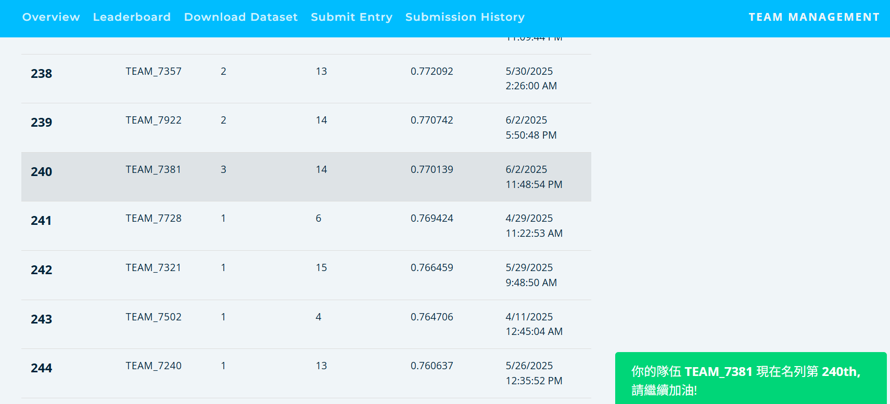

# AI CUP 2025 桌球智慧球拍資料分析

用球拍上的 IMU（三軸加速度 + 三軸角速度）揮拍訊號，預測選手的**性別、持拍手、球齡、程度等級**四項屬性。

**四項平均 OOF AUC 0.775，Public Leaderboard 0.770（第 240 名），比 Random Forest 基礎版提升約 0.24。**

> 機器學習課程期末專題，三人團隊（TEAM_7381）。

## 方法

```
原始 IMU .txt ──▶ 切成 27 次揮拍 ──▶ 每次揮拍 34 個特徵 ──▶ 彙整成 612 維檔案特徵 ──▶ LightGBM × 4 任務
                  (swing_features.py)                       (train_lgbm.py)          GroupKFold by player
```

1. **揮拍層級特徵（34 維）**：六軸平均、標準差、RMS；加速度／角速度強度的最大、平均、最小；自行實作 FFT 取頻域平均與功率譜密度；峰度、偏度、頻譜熵。
2. **檔案層級特徵（34 × 18 = 612 維）**：對 27 次揮拍的每個特徵計算 18 種統計量，除了 mean／std／分位數，也加入「前 5 次 vs 後 5 次」、極值出現在第幾次揮拍、相鄰揮拍差分，捕捉揮拍節奏與疲勞變化。
3. **模型**：四個任務各自訓練 `LGBMClassifier(n_estimators=200, class_weight='balanced')`，處理類別不平衡。
4. **驗證**：`GroupKFold(n_splits=5)` 以 `player_id` 分組，同一位選手不會同時出現在訓練與驗證集。
5. **上傳格式**：多分類機率四捨五入後重新正規化，每列總和誤差 < 1e-4。

## 結果

| 任務 | 類型 | OOF AUC |
|---|---|---|
| 持拍手 | 二分類 | 1.000 |
| 等級 | 四分類 | 0.777 |
| 性別 | 二分類 | 0.701 |
| 球齡 | 三分類 | 0.621 |
| **平均** | | **0.775** |



| 版本 | 模型 | 主要變更 | Public |
|---|---|---|---|
| 基礎版 | Random Forest | 每次揮拍當一筆樣本、依球員切分驗證集 | 0.531 |
| 最終版 | LightGBM | 612 維檔案層級特徵、GroupKFold、機率正規化 | **0.770** |



## 學到的事

- **驗證要依選手分組**：同一位選手的多筆資料若同時落在訓練與驗證集，模型會記住「這個人」而不是學到揮拍特徵，驗證分數會虛高。改用 GroupKFold 後，本地分數才和 Leaderboard 對得上。
- **樣本單位比模型更重要**：從「每次揮拍一筆」改成「每個檔案一筆 + 跨揮拍統計」，是分數從 0.53 跳到 0.77 的主因。
- **持拍手幾乎完美分類**，推測是左右手揮拍的角速度方向差異明顯；**球齡最難**（0.621），下一步會嘗試揮拍間隔、峰值間距等時間序列特徵，或用 1D-CNN／GRU 直接學原始訊號。

## 專案結構

```
├── src/
│   ├── swing_features.py   # 原始 IMU → 每次揮拍 34 個特徵
│   └── train_lgbm.py       # 612 維特徵 + LightGBM + GroupKFold + 產生上傳檔
├── experiments/
│   └── random_forest_baseline.py   # 基礎版（Public 0.531），版本對照用
└── images/
```

## 執行方式

比賽資料依規定不公開，請至 AI CUP 官網下載後放成以下結構：

```
data/
├── 39_Training_Dataset/
│   ├── train_data/        # <unique_id>.txt
│   └── train_info.csv
└── 39_Test_Dataset/
    └── test_data/         # <unique_id>.txt
```

```bash
pip install -r requirements.txt
python src/swing_features.py --data data/39_Training_Dataset/train_data --out data/tabular_data_train
python src/swing_features.py --data data/39_Test_Dataset/test_data --out data/tabular_data_test
python src/train_lgbm.py --data-root data
```

> 比賽期間最終版本只保留了程式截圖，`train_lgbm.py` 依截圖與當時的報告整理還原。
